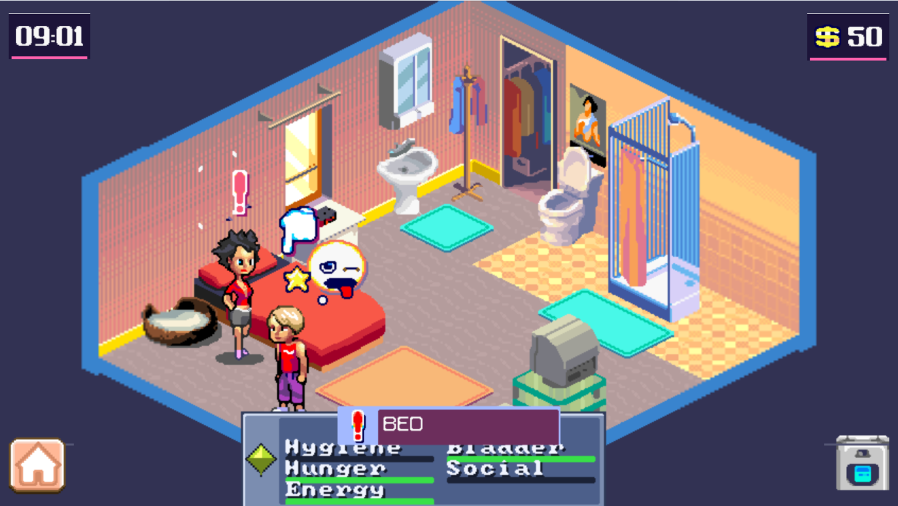

# MiamiNight — rebuild/ (MonoGame, .NET 8)

Playable reconstruction of the J2ME game
`Miami Nights - Singles in The City` (Samsung S8000 480x800).
This folder alone is all you need to build and run.



## Requirements

- .NET 8 SDK
- Git LFS (the MIDI SoundFont below is stored via LFS)
- Your own original `.jar` (not included in the repo)

## Run

```sh
cd rebuild
# place your .jar in this folder, then extract resources into res/:
#   res/0..21, res/dataIGP, res/icon.png, res/META-INF/...
dotnet build
dotnet run
```

`res/` is loaded by path, exactly like `getResourceAsStream` did
(`Midp.ResPath`). Do not commit `res/` (exception: `res/soundfont/`),
`*.jar`, `shot_f12.png`, or `crash.log`.

## Audio (MIDI)

The original used the phone's MMAPI synth, which MonoGame doesn't have.
Music therefore renders in one of two ways:

- **With SoundFont (default, recommended):** `res/soundfont/SGM-V2.01.sf2`
  is loaded through MeltySynth — real General MIDI instrument samples,
  so songs sound much closer to the original (correct instruments,
  structure, tempo and loop counts). Override with
  `MN_SOUNDFONT=<path to .sf2>`.
- **Without SoundFont:** falls back to a built-in SMF soft-synth
  (square/noise waves). Melody, tempo and loops are preserved,
  but timbre is clearly "chiptune" instead of the original instruments.

WAV sound effects always play through `SoundEffect` directly.

## Controls

Arrows/WASD = d-pad, Enter/Space/Z = fire, 0-9 = digits,
Esc/Backspace = softkeys, mouse click = pointer,
F10 = widescreen, F11 = fullscreen, F12 = dump `shot_f12.png`,
`#` = stats panel toggle.

Env: `MN_AUTO=1` autoplay harness, `MN_AI_LOG=1` NPC AI log,
`MN_EXPORT_MAPS=1` export `res/maps/lvl_*.svg`,
`MN_NO_SVGMAP=1` ignore collision SVGs.

## Folder contents

```
Program.cs, Game1.cs   # MIDlet lifecycle + 66 ms fixed-step driver
GloftMMN.cs            # resource container, string table, audio channels
a.cs                   # sprite + bitmap-font engine
b.cs d.cs e.cs         # small classes, flags, drawable wrapper
c.cs                   # IGP/RMS/dialogs/network
f.cs                   # world/levels, tilemap, collision grid (k/t/u)
g.cs                   # NPC/relationship simulation
h.cs                   # Canvas + state machine (~10k lines)
NpcAi.cs               # needs-driven NPC AI (optional, off original path)
StatsPanel.cs          # Sims-style player stats panel
Engine/                # Midp, Display, Rms, Audio, Collision, SvgMap,
                       # JavaRandom, Shims, Helpers, SimpleFont
res/                   # LOCAL, extracted from YOUR jar (git-ignored,
                       # except res/soundfont/ which ships via Git LFS)
art/                   # SVG sources (menu, bedroom)
tools/                 # extract_res.py, fixers, midi_probe.py, ...
```

Line-by-line port of the validated decompiles (`namespace MiamiNights`,
`sbyte` everywhere, `m_`/`_` naming rules — see `PORTING.md`).

## Limitations

- Without the SoundFont, MIDI timbre is a soft-synth approximation
  (structure/tempo/loops kept) — see Audio above.
- System font fallback is font8x8 (game text uses its own archives).
- `vibrate()` is a no-op, locale defaults to English.
- Occasional silent exit after minutes of play (no managed stack;
  see `STATUS.md` "Open issue"; `crash.log` sink plus
  `[QUIT-SITE-*]`/`[DRIVER]` markers are in place).
